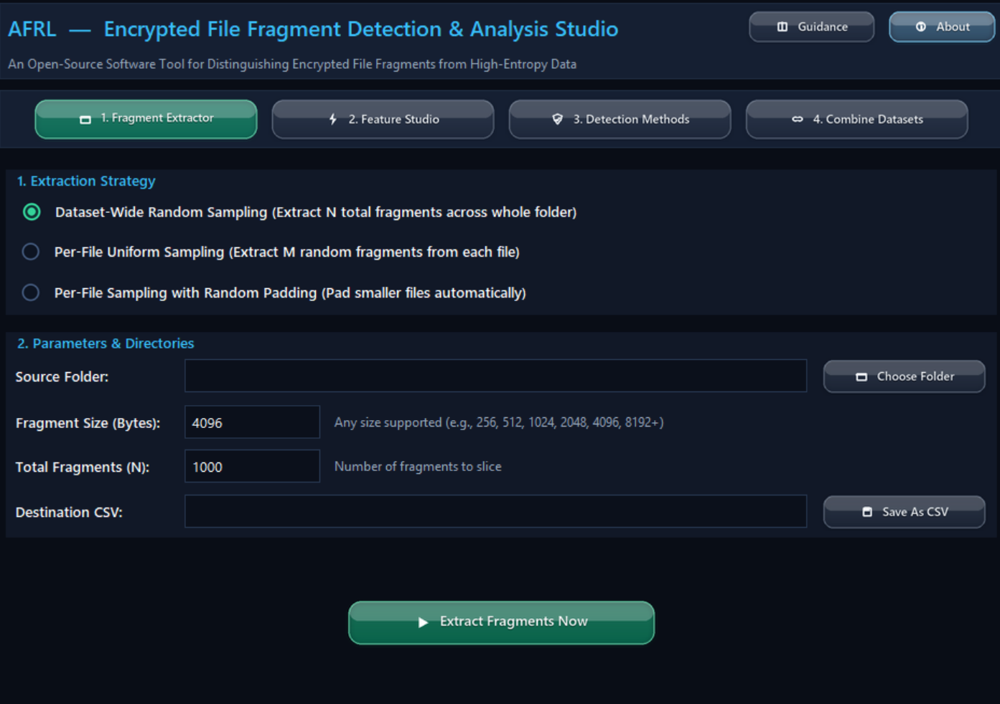
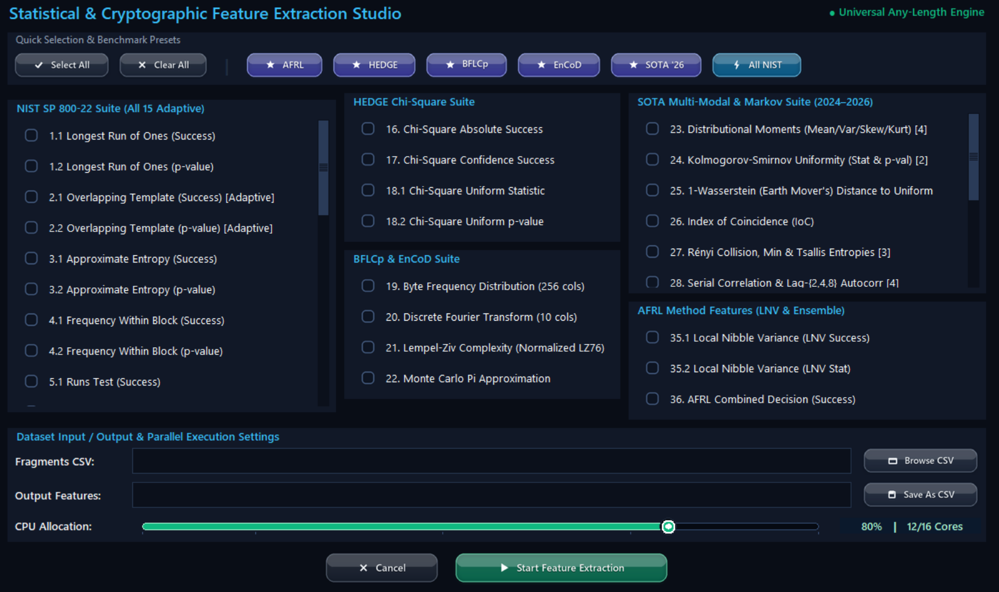
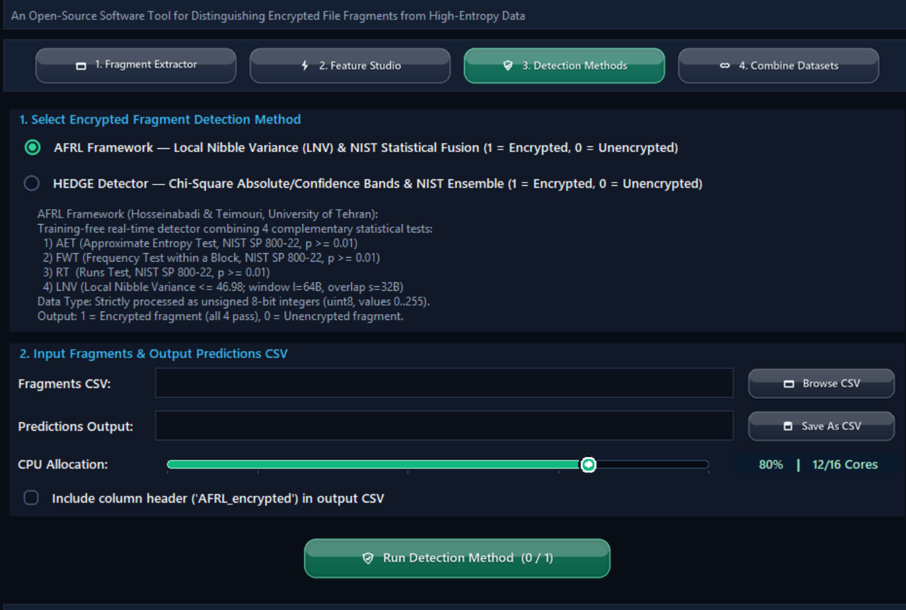
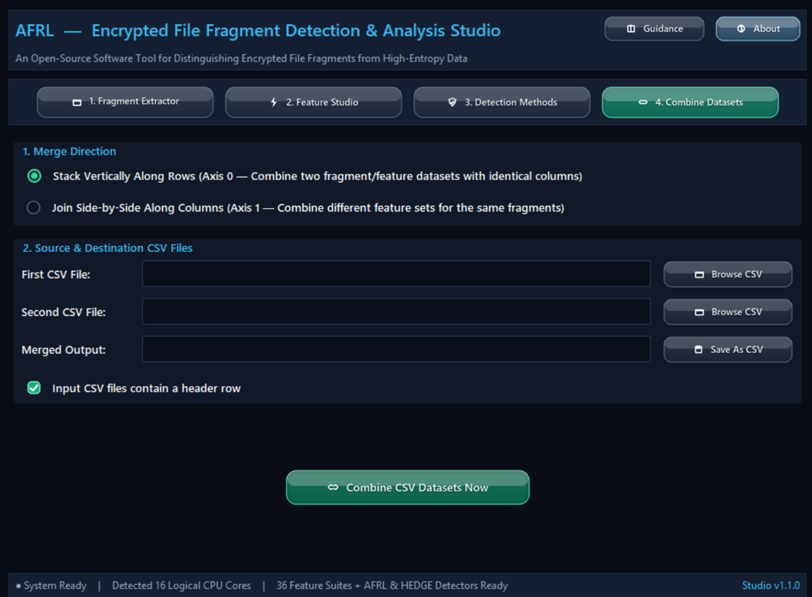

# AFRL: Encrypted File Fragment Detection & Feature Extraction Studio

[](https://www.python.org/)
[](https://www.gnu.org/licenses/gpl-3.0)
[](https://github.com/)
[-10B981?style=for-the-badge&logo=windows)](https://github.com/luciunfair/AFRL_Studio/releases/tag/v1.1.0)

**AFRL Studio** is an open-source software suite and GUI framework designed for distinguishing encrypted file fragments from high-entropy unencrypted data (such as compressed archives, multimedia streams, and packed executables). Based on research from the **University of Tehran**, AFRL combines real-time statistical hypothesis testing, local nibble variance analysis, and comprehensive feature extraction across a high-performance multi-core pipeline.

---

## Table of Contents

- [Overview & Research Background](#overview--research-background)
- [Key Features](#key-features)
- [Software Architecture & Pipeline](#software-architecture--pipeline)
- [GUI Screenshots Gallery](#gui-screenshots-gallery)
- [Installation & Direct EXE Download](#installation--direct-exe-download)
  - [Option A: Direct Executable Download (Recommended)](#option-a-direct-executable-download-recommended)
  - [Option B: Running from Source](#option-b-running-from-source)
  - [Option C: Building Standalone Executable (.exe)](#option-c-building-standalone-executable-exe)
- [4-Stage Workflow Guide & Examples](#4-stage-workflow-guide--examples)
  - [Stage 1: Fragment Extractor](#stage-1-fragment-extractor)
  - [Stage 2: Feature Studio (36 Suites / 359 Columns)](#stage-2-feature-studio-36-suites--359-columns)
  - [Stage 3: Detection Methods (AFRL & HEDGE)](#stage-3-detection-methods-afrl--hedge)
  - [Stage 4: CSV Dataset Combiner](#stage-4-csv-dataset-combiner)
- [Sample Dataset & Performance Benchmark](#sample-dataset--performance-benchmark)
- [Directory Structure](#directory-structure)
- [Citation](#citation)
- [License](#license)

---

## Overview & Research Background

Distinguishing encrypted data fragments from compressed or high-entropy unencrypted data is a critical challenge in digital forensics, network traffic analysis, ransomware early detection, and storage classification. Traditional entropy measures (e.g., Shannon entropy) fail because both compressed and encrypted payloads exhibit near-maximal entropy ($H \approx 8.0$ bits/byte).

**AFRL (A Lightweight Statistical Framework for Real-Time Detection of Encrypted File Fragments)** introduces a multi-stage decision fusion model:
1. **Local Nibble Variance (LNV):** Analyzes non-uniformity across 4-bit nibble distributions using sliding 64-byte windows ($l=64$) with 50% overlap ($s=32$).
2. **NIST SP 800-22 Statistical Fusion:** Integrates Approximate Entropy (AET), Frequency within a Block (FWT), and Runs Tests (RT).
3. **Training-Free Zero-Day Classification:** Achieves high accuracy on standard benchmarks without requiring machine learning training or pre-labeled models.

---

## Key Features

* **Universal Any-Length Adaptation:** Automatically scales block sizes, degrees of freedom, and statistical thresholds for fragment lengths ranging from 256 bytes to 8192+ bytes.
* **36 Feature Extraction Suites (359 Columns):** Complete implementation of NIST SP 800-22 (all 15 adaptive tests), HEDGE Chi-Square, BFLCp (LZ76, DFT, Monte Carlo $\pi$), EnCoD (256-byte distribution), AFRL, and SOTA multi-modal suites (Markov bigrams, Wiener spectral flatness, Haar wavelets, Rényi/Min/Tsallis entropies, Kolmogorov incompressibility).
* **Direct Binary Classification Studio:** One-click execution of the **AFRL Framework** and **HEDGE Ensemble** detectors directly on raw byte fragment CSVs (outputting `1 = Encrypted`, `0 = Unencrypted`).
* **Multi-Core Parallel Execution:** Chunk-buffered streaming engine using Python `multiprocessing` with custom CPU allocation control to process multi-gigabyte datasets without RAM exhaustion.
* **Modern Obsidian-Glass UI:** Sleek GUI built with FreeSimpleGUI, PIL vector rendering, high-contrast custom Canvas controls, and live execution progress tracking (ETR, chunk throughput, core utilization).

---

## Software Architecture & Pipeline

```
                               ┌─────────────────────────────────────────┐
                               │           Raw Dataset Folder            │
                               │  (Executables, Media, Encrypted, etc.)  │
                               └────────────────────┬────────────────────┘
                                                    │
                                                    ▼
┌────────────────────────────────────────────────────────────────────────────────────────────────────────┐
│ STAGE 1: FRAGMENT EXTRACTOR                                                                           │
│ • Dataset-Wide Random Sampling  │  • Per-File Uniform Sampling  │  • Random Padded Slicing             │
└───────────────────────────────────────────────────┬────────────────────────────────────────────────────┘
                                                    │
                                                    ▼
                               ┌─────────────────────────────────────────┐
                               │       Raw Byte Fragments (CSV)          │
                               │   (256B, 512B, 1024B, 4096B, 8192B+)    │
                               └──────────┬───────────────────┬──────────┘
                                          │                   │
                     ┌────────────────────┘                   └────────────────────┐
                     ▼                                                             ▼
┌────────────────────────────────────────┐                   ┌───────────────────────────────────────────┐
│ STAGE 2: FEATURE EXTRACTION STUDIO     │                   │ STAGE 3: DIRECT DETECTION METHODS         │
│ • Extract up to 359 Features           │                   │ • AFRL Detector (LNV + AET + FWT + RT)    │
│ • NIST 1-15, HEDGE, BFLCp, SOTA, AFRL  │                   │ • HEDGE Detector (Chi2 + NIST Ensemble)   │
└────────────────────┬───────────────────┘                   └─────────────────────┬─────────────────────┘
                     │                                                             │
                     ▼                                                             ▼
┌────────────────────────────────────────┐                   ┌───────────────────────────────────────────┐
│ Output: Feature Matrix CSV             │                   │ Output: Binary Predictions CSV            │
│ (Ready for ML/DL Model Training)       │                   │ (1 = Encrypted, 0 = Unencrypted)          │
└────────────────────┬───────────────────┘                   └───────────────────────────────────────────┘
                     │
                     └──────────────────────────────────────┐
                                                            ▼
                                         ┌───────────────────────────────────┐
                                         │ STAGE 4: DATASET COMBINER         │
                                         │ • Vertical Stack (Axis 0 / Rows)  │
                                         │ • Horizontal Join (Axis 1 / Cols) │
                                         └───────────────────────────────────┘
```

---

## GUI Screenshots Gallery

Explore the main application views and module interfaces:

### 1. Fragment Extractor Module
Slices dataset directories into byte fragment CSV files with custom length and sampling rules.
<p align="center">
  
</p>

### 2. Feature Extraction Studio
Select from 36 statistical suites (359 feature columns) with multi-core parallel processing controls.
<p align="center">
  
</p>

### 3. Encrypted Fragment Detection Methods
Direct threshold-based binary classification (AFRL Framework & HEDGE Ensemble) outputting 0/1 predictions.
<p align="center">
  
</p>

### 4. CSV Dataset Combiner
Merge feature and fragment datasets vertically along rows (Axis 0) or horizontally along columns (Axis 1).
<p align="center">
  
</p>

---

## Installation & Direct EXE Download

### Option A: Direct Executable Download (Recommended)

You can download the pre-compiled, standalone Windows application without needing Python or any dependency installation:

1. Visit the **[Latest Release Page (v1.1.0)](https://github.com/luciunfair/AFRL_Studio/releases/tag/v1.1.0)**.
2. Download the `AFRL_Studio.zip` archive from assets.
3. Extract the ZIP file and run `AFRL_Studio.exe`.

---

### Option B: Running from Source

1. **Clone the Repository:**
   ```bash
   git clone https://github.com/luciunfair/AFRL_Studio.git
   cd AFRL_Studio
   ```

2. **Create and Activate a Virtual Environment:**
   ```bash
   # Windows (PowerShell)
   python -m venv venv
   .\venv\Scripts\Activate.ps1

   # Linux / macOS
   python3 -m venv venv
   source venv/bin/activate
   ```

3. **Install Dependencies:**
   ```bash
   pip install -r requirements.txt
   ```

4. **Launch the GUI Application:**
   ```bash
   python MainGui.py
   ```

---

### Option C: Building Standalone Executable (.exe)

To package the application manually using PyInstaller:

1. **Install PyInstaller:**
   ```bash
   pip install pyinstaller
   ```

2. **Run PyInstaller Build Command:**
   ```bash
   pyinstaller --noconfirm --onedir --windowed \
     --name "AFRL_Studio" \
     --icon="icons/main_icon.ico" \
     --add-data "icons;icons" \
     --add-data "fragment_extractor;fragment_extractor" \
     --add-data "feature_extractor;feature_extractor" \
     --add-data "combine_csv;combine_csv" \
     MainGui.py
   ```

3. Locate the executable in `dist/AFRL_Studio/AFRL_Studio.exe`.

---

## 4-Stage Workflow Guide & Examples

### Stage 1: Fragment Extractor

Slices binary files from a source directory into standardized, unsigned 8-bit byte fragment vectors ($0 \dots 255$).

#### Extraction Modes
* **Dataset-Wide Random Sampling:** Slices $N$ total fragments across all files in a folder.
* **Per-File Uniform Sampling:** Slices $M$ random fragments per file.
* **Per-File Sampling with Random Padding:** Pads files smaller than the fragment size using random bytes before extraction.

---

### Stage 2: Feature Studio (36 Suites / 359 Columns)

Extracts cryptographic and statistical metrics per fragment row for machine learning model training.

#### Included Benchmark Presets

| Preset | Extracted Features / Columns | Primary Target Application |
| :--- | :--- | :--- |
| **AFRL Preset** | `3_1` (AET), `4_1` (FWT), `5_1` (RT), `35_1` (LNV Success), `35_2` (LNV Stat), `36` (AFRL Combined) | Lightweight Real-Time Classification |
| **HEDGE Preset** | `3_1` (AET), `4_1` (FWT), `8_1` (Cusum), `16` (Chi2 Abs), `17` (Chi2 Conf) | Chi-Square & NIST Ensemble Benchmark |
| **EnCoD Preset** | 256 Normalized Byte Frequencies (`B0_freq` $\dots$ `B255_freq`) | Deep Learning / MLP Classifier Features |
| **BFLCp Preset** | Chi2 Stat/p-val, 256 Byte Frequencies, 10 DFT Coeffs, LZ76 Complexity, Monte Carlo $\pi$ | Statistical Complexity Profiling |
| **SOTA Preset** | Moments, KS-Test, 1-Wasserstein, IoC, Rényi/Min/Tsallis Entropies, Autocorrelation, Markov Bigram & MI, Recompression, Wavelet Detail, SFM, ASCII | Comprehensive Multi-Modal Feature Vector |
| **All NIST** | All 15 NIST SP 800-22 Randomness Tests (Adaptive P-Values & Pass/Fail Decisions) | Formal Cryptographic Randomness Evaluation |

---

### Stage 3: Detection Methods (AFRL & HEDGE)

Direct binary classification studio that evaluates raw fragment CSV files without requiring training machine learning models.

#### Supported Methods

1. **AFRL Lightweight Framework:**
   * **Rule:** $\text{LNV} \le 46.98 \land p_{\text{AET}} \ge 0.01 \land p_{\text{FWT}} \ge 0.01 \land p_{\text{RT}} \ge 0.01 \implies 1 \text{ (Encrypted)}$, else $0$.
2. **HEDGE Ensemble Detector:**
   * **Rule:** Evaluates 5 conditions: AET, FWT, Cumulative Sums, Chi-Square Absolute Band ($\mu \pm 2\sigma$), and Chi-Square Confidence Interval ($0.01 \le p \le 0.99$).

---

### Stage 4: CSV Dataset Combiner

Merges CSV files vertically along rows (Axis 0) or side-by-side along columns (Axis 1).

---

## Sample Dataset & Performance Benchmark

The repository includes a benchmark dataset in `sample_dataset/sample_dataset.csv` containing:
* **Rows 1 to 10:** Unencrypted fragments (High-entropy compressed/media data).
* **Rows 11 to 20:** Encrypted fragments (AES-256 encrypted payload).

### Comparative Method Evaluation

Running both detection methods on `sample_dataset/sample_dataset.csv` yields the following performance results:

| Detection Method | Unencrypted Accuracy (Rows 1–10) | Encrypted Accuracy (Rows 11–20) | Overall Accuracy |
| :--- | :--- | :--- | :--- |
| **AFRL Framework** | **8 / 10 (100%)** | **10 / 10 (100%)** | **18 / 20 (90.0%)** |
| **HEDGE Detector** | **10 / 10 (100%)** | **6 / 10 (60%)** | **16 / 20 (80.0%)** |

#### Output Benchmark CSV Files

* **AFRL Framework Output (`output_sample/AFRL_detection/AFRL_detection.csv`):**
  ```csv
  AFRL_encrypted
  0
  0
  0
  0
  0
  1
  1
  0
  0
  0
  1
  1
  1
  1
  1
  1
  1
  1
  1
  1
  ```

* **HEDGE Detector Output (`output_sample/HEDGE_detection/HEDGE_detection.csv`):**
  ```csv
  HEDGE_encrypted
  0
  0
  0
  0
  0
  0
  0
  0
  0
  0
  1
  0
  1
  1
  1
  0
  1
  0
  1
  0
  ```

---

## Directory Structure

```text
AFRL_Studio/
├── MainGui.py                     # Main Obsidian-Glass Application & GUI Pipeline
├── AFRL_fspecials.py              # AFRL LNV & Decision Fusion Core Engine
├── HEDGE_fspecials.py             # HEDGE Chi-Square & Ensemble Suite
├── BLFCP_fspecials.py             # BFLCp & EnCoD Feature Extractor
├── SOTA_fspecials.py              # Multi-Modal, Markov & Spectral Feature Engine
├── combine.py                     # High-Performance CSV Streaming Merger
├── requirements.txt               # Dependency Requirements
├── LICENSE                        # GNU General Public License v3.0
├── README.md                      # Project Documentation
│
├── fragment_extractor/            # Slicing Engine Modules
│   ├── extract_whole_folder_fragments.py
│   └── extract_each_file_fragments.py
│
├── feature_extractor/             # Feature Suites & NIST Submodules
│   ├── NIST/                      # NIST SP 800-22 Python Port
│   ├── AFRL_specials/
│   ├── HEDGE_specials/
│   ├── BLFCP_specials/
│   └── SOTA_specials/
│
├── icons/                         # Application Icons & Vector Assets
│   ├── main_icon.png
│   └── main_icon.ico
│
├── sample_dataset/                # Benchmark Sample Files
│   ├── sample_dataset.csv
│   └── sample.py
│
├── output_sample/                 # Sample Output Predictions & Feature Matrices
│   ├── AFRL_detection/
│   │   └── AFRL_detection.csv
│   ├── HEDGE_detection/
│   │   └── HEDGE_detection.csv
│   └── all_features/
│       └── all_features.csv
│
└── screenshots/                   # GUI Documentation Images
    ├── Fragment_Extractor.png
    ├── Feature_Studio.png
    ├── Detection_Methods.png
    └── Combine_Dataset.png
```

---

## License

This project is licensed under the **GNU General Public License v3.0 (GPL-3.0)**.  
Feel free to use, modify, and distribute this software in accordance with GPL-3.0 terms.